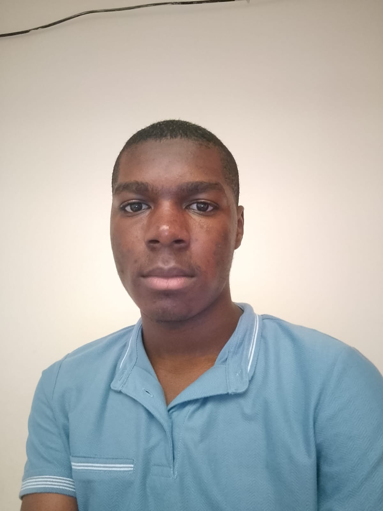
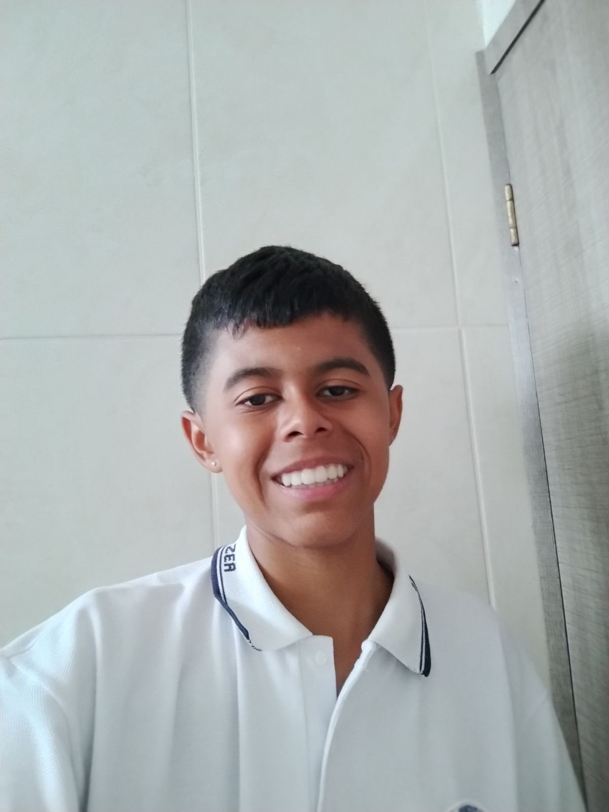

# Institución universitaria pascual bravo
<h2>Programa: Tecnología en Desarrollo de Software</h2>
<h3> Curso: Base de Datos (SD1006)
 Profesor: Jaime E. Soto U.
 Equipo-A </h3>
Proposito

Este repositorio contiene las tareas básicas del curso Base de Datos |, desarrollasdas por el equipo de trabajo como parte de la evaluacion del semestre.
Cada carpeta corresponde  a una de las tareas solicitadas en clase.

<h1>Miembros del equipo</h1>

 <h2>Yeiler Andrés Palacios Palacios - líder del equipo</h2>
  <h2>Santiago Otalvaro - Integrante del equipo</h2>
  <h2>Daniel Rico - Integrante del equipo</h2>
